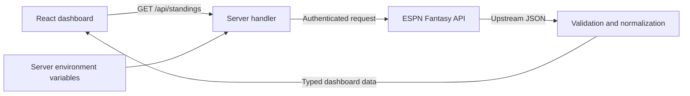

# Architecture

Family League Legacy separates the React interface, league domain models, and ESPN integration so the dashboard can evolve without depending on ESPN's response structure.

[Development](development.md) · [Engineering Decisions](engineering-decisions.md) · [Roadmap](roadmap.md)

---

## Data Flow



The browser calls its own origin. On Vercel, `api/standings.ts` exposes a Node function; locally, Vite middleware serves the same handler. `server/espn.ts` fetches and validates ESPN data before returning a limited set of dashboard fields.

The hook loads data when the dashboard mounts or is retried. There is no automatic polling, database, or persistent server cache in the current milestone.

## Repository Structure

```text
api/standings.ts                       Vercel function entry point
server/espn.ts                         ESPN fetching and normalization
server/standings-handler.ts            Shared HTTP handler
src/
├── components/
│   ├── data/mockLeagueData.ts          Explicit sample fallback
│   ├── data/standingsSort.ts           Table display sorting
│   ├── pages/DashboardPage.tsx         Dashboard composition
│   ├── types/league.ts                Domain contracts
│   ├── DetailCard.tsx                 Reusable summary card
│   ├── Footer.tsx                     Year and package version
│   └── Header.tsx                     League branding
├── config/leagueBranding.ts            League identity
├── hooks/useLeagueDashboard.ts        Request lifecycle
├── App.tsx                            Theme state and application shell
├── App.css                            Layout and theme tokens
└── main.tsx                           React entry point
tests/                                Adapter, HTTP, and sorting tests
```

## Domain Contracts

| Model | Responsibility |
| --- | --- |
| `FantasyTeam` | ESPN team ID, team/owner names, W-L-T record, points, differential, and nullable historical achievements |
| `LeagueSeasonContext` | Nullable previous-season champion team ID |
| `LeagueDashboardData` | Teams, season context, season, source, fetch timestamp, and optional official standings order |

TypeScript defines the application contract; runtime validation checks upstream JSON. ESPN team IDs are preserved, owner IDs are resolved into display names, and raw member records are discarded.

Current-season data cannot establish lifetime playoff appearances or championships. Those values are `null`, displayed as unavailable. The previous-season champion remains unset until the preceding season's result is supplied.

## Ranking and Display Sorting

Complete, unique ESPN playoff seeds determine official rank. When they are unavailable, ranking falls back to wins, ties, point differential, and points for.

The table's display order is independent of official ranking. Sorting any header changes rows without changing rank labels, the current leader, the leader highlight, or team-detail ranks. Record sorting uses win percentage with half-credit for ties and a zero-games guard. Equal values retain official rank order.

## Request States

`useLeagueDashboard` exposes loading, ready, and error states with abort cleanup. Failed requests offer retry and an explicit sample-dashboard option. Sample teams remain separate from live data and carry a visible label; real teams never receive illustrative achievements.

## Server Boundary

- `ESPN_S2` and `ESPN_SWID` are read only from server environment variables.
- The API returns normalized standings, names, scores, and source metadata; it does not return cookies, raw ESPN responses, or member email addresses.
- Upstream requests use a fixed host and configured league/season, reject redirects, and time out after 12 seconds.
- Credentials are checked for invalid header characters. Client errors are sanitized and responses use `Cache-Control: no-store`.
- The deployed dashboard is publicly readable. Keeping cookies private does not make the returned standings private; league-member access control is not implemented.

See [ESPN Setup](espn-setup.md) for configuration and credential maintenance.

## Presentation and Accessibility

`App` owns light/dark theme state, persists it in `localStorage`, and applies semantic CSS tokens through the root `data-theme` attribute. League identity is configured separately from statistics and presentation.

The standings use a semantic table with scoped headers, native sort buttons, `aria-sort`, and a keyboard-focusable horizontal scroll region. Team cards use native `details`/`summary` disclosures and definition lists. Display typography adds character while the body font and tabular numerals keep statistics readable.

React Router, Supabase, PostgreSQL, and third-party state-management libraries are future options, not current dependencies.
